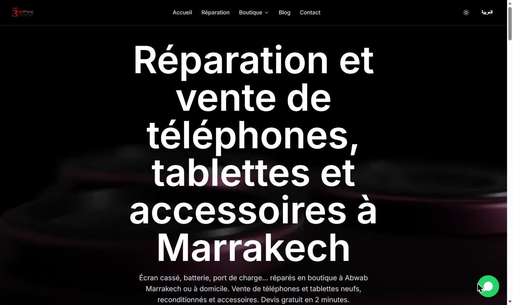

# RedPhone Marrakech

🔗 **[https://redphonemarrakech.ma](https://redphonemarrakech.ma)**



## Aperçu

Site web d'une boutique de réparation et de vente de smartphones, tablettes et
accessoires à Marrakech. Les visiteurs peuvent consulter la boutique en ligne,
demander un devis de réparation, estimer la reprise de leur ancien téléphone et
lire le blog. Le site est bilingue, en français et en arabe (mise en page RTL).

## Mon rôle

Développeur full stack (stagiaire) : projet réalisé pour un client lors de mon stage
chez Irrigation El Kelaa (juillet – août 2026). J'ai pris en charge le développement,
la mise en place du SEO technique et la mise en production.

## Fonctionnalités

- Boutique : catalogue de téléphones et tablettes neufs ou reconditionnés, et d'accessoires
- Formulaire de devis de réparation en plusieurs étapes
- Estimation de reprise d'un ancien téléphone
- Blog et FAQ
- Bilingue français / arabe avec support RTL
- Thème clair / sombre
- Contact rapide par messagerie instantanée

## Stack technique

| Domaine     | Technologies                                         |
| ----------- | ---------------------------------------------------- |
| Framework   | Next.js (React), rendu côté serveur (SSR)            |
| Images      | next/image (optimisation et formats modernes)        |
| i18n        | Français / arabe, URL localisées, RTL                |
| Déploiement | Docker, Railway, Cloudflare (DNS, CDN, SSL)          |
| Suivi       | Google Search Console, Google Analytics              |

## Architecture & déploiement

```
Next.js → Docker → Railway → Cloudflare (DNS · CDN · SSL) → Utilisateur
```

## SEO

Mise en place initiale du SEO technique (setup, sans maintenance continue) :
- Rendu côté serveur (SSR) pour une indexation complète
- Balises méta, URL canoniques, balises Open Graph
- Sitemap et balises hreflang (fr, ar, x-default)
- Données structurées JSON-LD (schema.org) : RepairShop, Review, FAQPage
- Configuration de Google Search Console et de Google Analytics

## Compétences démontrées

- Développement full stack avec Next.js et React
- Site multilingue avec support RTL
- SEO technique (SSR, données structurées, hreflang, sitemap)
- Conteneurisation (Docker) et déploiement cloud (Railway, Cloudflare)
- Livraison d'un projet en production pour un client réel

## Note

Projet réalisé pour un client lors de mon stage chez Irrigation El Kelaa.
Le code source est la propriété du client et reste privé.
